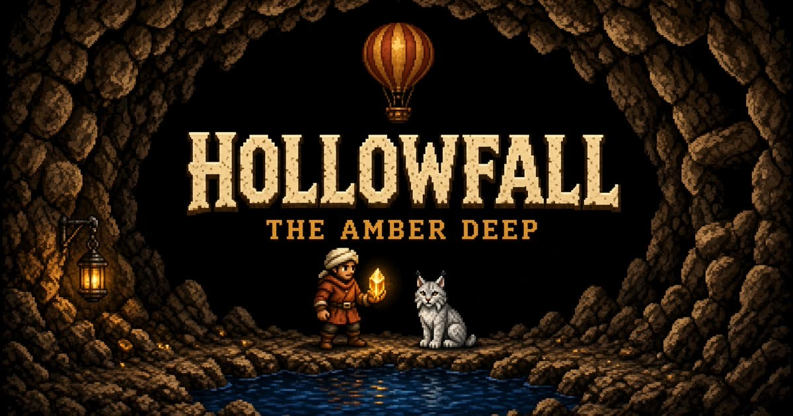
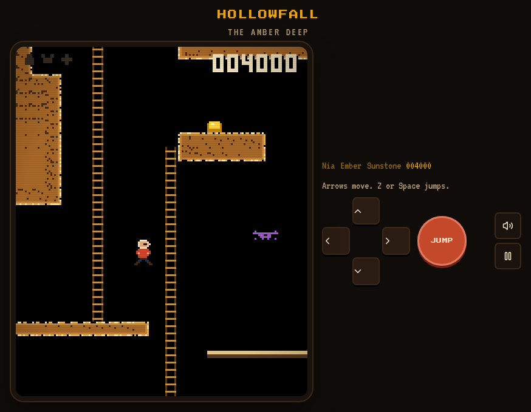

# Hollowfall

**The Amber Deep**

An original cavern explorer. Kit Calder goes down for three things the mountain kept: **Nia**, **Ember** the silver lynx, and the **Sunstone**. Bring them back to daylight.



## In the cavern

Ladders, a red balloon, a dark lake, and a score that only stays if you bank it at a lantern.



## How to play

- **Move** with the arrows or WASD. A is left, D is right.
- **Jump** with Space, Z, or J. **Up** climbs a ladder and grabs the balloon.
- **Gold** adds to the score. **Lanterns bank it.** Fall, and a spark flies home to the last lantern while anything you have not banked burns off.
- Swim the lake. Ride the balloon across the chasm. You cannot jump to that high ledge.
- Find all three relics, then climb back out through the mouth in the ridge.

Scorpions, bats, eels, and a condor will knock you back. Your best score stays in this browser.

## Where to look

The cavern is a few files. The rest of the tree is the app shell.

- [`src/game/engine.ts`](src/game/engine.ts) — movement, collision, camera, scoring, and the draw loop
- [`src/game/level.ts`](src/game/level.ts) — the cave: ridge, ladders, lake, balloon ledge, and the three relics
- [`src/game/audio.ts`](src/game/audio.ts) — the chiptune
- [`src/game/sprites.ts`](src/game/sprites.ts) — Kit, Ember, and the creatures
- [`src/components/hollowfall.tsx`](src/components/hollowfall.tsx) — the screen, buttons, and touch controls

`src/lib`, `scripts`, and `server` are auth, database bootstrap, and the install page. Skip them if you only want the game.

## Run it

```bash
npm install
npm run dev
```

The dev server starts on port 8080.

## License

[MIT](LICENSE). That covers this game's code and original art. The pixel fonts are loaded from Google Fonts under their own licenses, and npm packages keep theirs.
